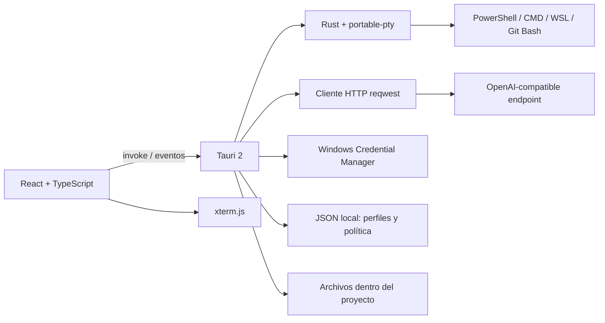
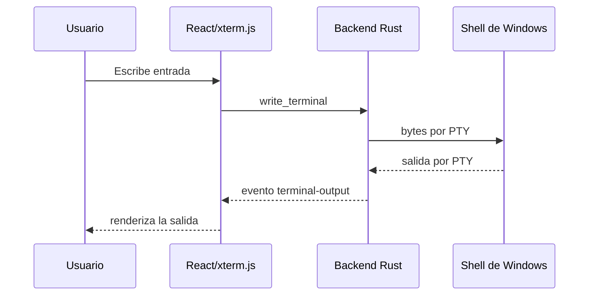

# Arquitectura

## Estado

Esta página describe la implementación inicial, y señala dónde termina la implementación y empieza la intención de producto. No afirma aislamiento del agente ni soporte completo de cualquier proveedor OpenAI-compatible.

## Componentes

## Responsabilidades

### UI (React/TypeScript)

Administra pestañas, shell seleccionado, directorio del proyecto, contexto elegido, chat, planes de agente y confirmaciones. Renderiza la terminal mediante xterm.js y convierte entrada/salida a invocaciones/eventos Tauri.

### Shell nativo (Rust)

`portable-pty` abre un pseudo-terminal para el shell seleccionado. Rust mantiene sesiones, redimensiona la terminal y envía bytes de salida al frontend. Los comandos del agente se escriben en una sesión de shell existente.

### Proveedores

El cliente Rust usa HTTP para consultar `/models` y enviar solicitudes no-streaming a `/chat/completions`. El identificador de modelo, URL base y nombre se guardan en `providers.json`; la clave se busca por perfil en el almacén del sistema operativo.

### Agente

El modelo propone un JSON con resumen, comandos y archivos. Rust valida el formato, las rutas relativas y tamaños. Los comandos pasan por la política del usuario; las escrituras de archivo exigen aprobación y guardan una copia de archivos existentes. No hay bucle autónomo de herramientas ilimitado.

### Almacenamiento local

- `providers.json`: perfiles sin secretos y perfil activo.
- `agent.json`: modo y prefijos permitidos.
- Windows Credential Manager: secretos por proveedor.
- Archivos de proyecto: solo archivos explícitamente aprobados por la persona.
- Historial de chat persistente: aún no implementado.

## Flujos de datos

### Terminal

### Chat contextual

## Límites y evolución

- La terminal es un shell con los permisos del usuario de Windows; Laural no lo sandboxea.
- El modo automático usa comprobaciones heurísticas y no reemplaza el consentimiento informado ni controles del sistema operativo.
- La autorización de una acción del agente no significa que la operación sea reversible.
- El contexto se envía al endpoint elegido por el usuario. Un endpoint remoto puede almacenar solicitudes según sus propias condiciones.
- Streaming, persistencia de conversaciones, detección de bloques y cancelación se diseñarán e implementarán después del primer esqueleto.
- Sincronización no forma parte de esta arquitectura inicial.

## Estructura de código

| Ruta | Propósito |
| --- | --- |
| `src/App.tsx` | Estado y composición principal de interfaz |
| `src/components/TerminalPane.tsx` | xterm.js, eventos de salida y entrada de terminal |
| `src-tauri/src/lib.rs` | PTY, ejecución controlada de comandos y escrituras de archivo |
| `src-tauri/src/providers.rs` | Proveedores, contexto, chat, planes y política del agente |
| `src-tauri/capabilities/default.json` | Permisos Tauri explícitos |
