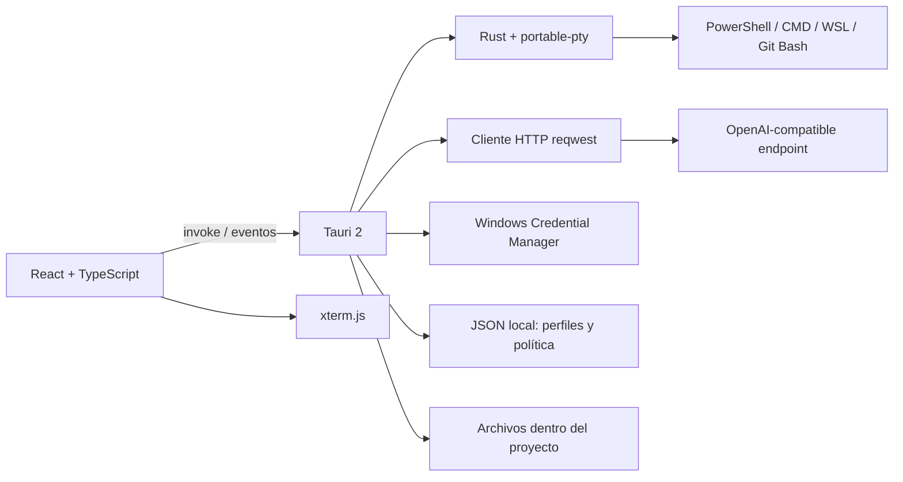
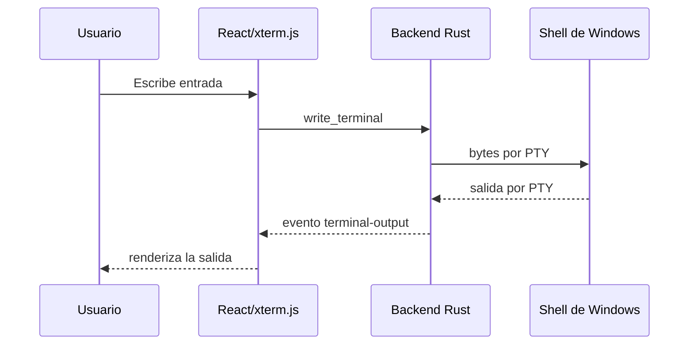
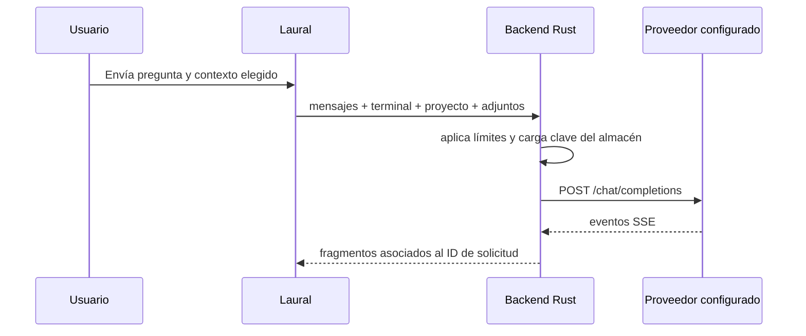
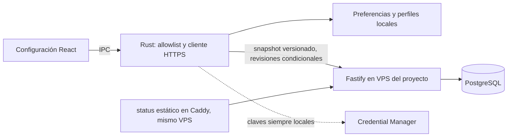

# Arquitectura

## Estado

Esta página describe la implementación inicial, y señala dónde termina la implementación y empieza la intención de producto. No afirma aislamiento del agente ni soporte completo de cualquier proveedor OpenAI-compatible.

## Componentes

## Responsabilidades

### UI (React/TypeScript)

Administra pestañas, shell seleccionado, directorio del proyecto, contexto elegido, chat, planes de agente y confirmaciones. Renderiza la terminal mediante xterm.js y convierte entrada/salida a invocaciones/eventos Tauri.

La apariencia se administra en React y se aplica con atributos CSS `data-theme`/`data-mode` y propiedades personalizadas. La paleta de 12 temas y el modo claro/oscuro se guardan en `localStorage` del WebView; actualizar los colores de xterm.js no debe destruir la sesión PTY.

### Shell nativo (Rust)

`portable-pty` abre un pseudo-terminal para el shell seleccionado. Rust mantiene sesiones, redimensiona la terminal y envía bytes de salida al frontend. Cada terminal marca entrada con OSC 133 para delimitar bloques y devolver códigos de salida cuando el shell lo permite. Las marcas son locales a la sesión; no se escriben perfiles persistentes del usuario.

### Proveedores

El cliente Rust usa HTTP para consultar `/models` y enviar solicitudes en streaming a `/chat/completions`. Los eventos de fragmentos se asocian al identificador de la petición; el registro local permite cancelarla. `preview_context` devuelve los mismos recortes de terminal, proyecto y archivos que usa el envío. El identificador de modelo, URL base y nombre se guardan en `providers.json`; la clave se busca por perfil en el almacén del sistema operativo.

### Agente

El modelo propone un JSON con resumen, comandos y archivos. Rust valida el formato, las rutas relativas y tamaños. Los comandos pasan por la política del usuario; el plan puede cancelarse, cada comando se espera hasta su marca de finalización y se puede transmitir Ctrl+C al PTY. Las escrituras de archivo exigen aprobación y guardan una copia de archivos existentes. No hay bucle autónomo de herramientas ilimitado.

### Almacenamiento local

- `providers.json`: perfiles sin secretos y perfil activo.
- `agent.json`: modo y comandos exactos permitidos.
- `localStorage`: tema, modo de apariencia e historial acotado de hasta 100 mensajes.
- Memoria de UI: historial efímero de hasta 100 comandos para la paleta; no se conserva tras cerrar la app.
- Windows Credential Manager: secretos por proveedor.
- Archivos de proyecto: solo archivos explícitamente aprobados por la persona.
- Bloques de comando: estado en memoria de la sesión, hasta 160 por aplicación.

## Flujos de datos

### Terminal

### Chat contextual

## Límites y evolución

- La terminal es un shell con los permisos del usuario de Windows; Laural no lo sandboxea.
- El modo automático usa comprobaciones heurísticas y no reemplaza el consentimiento informado ni controles del sistema operativo.
- La autorización de una acción del agente no significa que la operación sea reversible.
- El contexto se envía al endpoint elegido por el usuario. Un endpoint remoto puede almacenar solicitudes según sus propias condiciones.
- Las marcas de bloques y códigos de salida varían por shell; PowerShell, CMD y Bash están instrumentados inicialmente. Scripts de inicio pueden sobrescribir `PROMPT_COMMAND` y comandos interactivos pueden no terminar solos.
- La vista previa representa el contenido recogido al abrirla; la terminal puede producir más salida antes de enviar.
- Sincronización no forma parte de esta arquitectura inicial.

## Extensión aprobada: portabilidad local y sync

El diseño posterior aprobado añade una superficie opcional sin cambiar el funcionamiento local actual:

La portabilidad local ya cuenta con un módulo Rust para el formato `.laural`, validación, cifrado y descifrado, y comandos Tauri para vista previa, exportación e importación. La UI nativa de Configuración permite fusionar o reemplazar perfiles. Las claves se escriben en Windows Credential Manager; las copias previas se guardan localmente. Falta validar fallos reales y recuperación en Windows. La fase de sincronización define un contrato cerrado v1 con schema compartido y tipos Rust/TypeScript y construye snapshots desde preferencias y metadatos permitidos mediante el backend nativo. Los perfiles guardan el tipo y el consentimiento opcional del endpoint, falso por defecto, con migración compatible. Todavía no se contacta un servidor: backend de cuentas, cliente de sync y status público siguen pendientes. Ver el [diseño formal](../designs/sincronizacion-preferencias-y-portabilidad.md) y el [plan de entrega](../plans/sincronizacion-preferencias.md).

## Estructura de código

| Ruta | Propósito |
| --- | --- |
| `src/App.tsx` | Estado y composición principal de interfaz |
| `src/components/TerminalPane.tsx` | xterm.js, eventos de salida y entrada de terminal |
| `src-tauri/src/lib.rs` | PTY, ejecución controlada de comandos y escrituras de archivo |
| `src-tauri/src/providers.rs` | Proveedores, contexto, chat, planes y política del agente |
| `src-tauri/src/activity_log.rs` | Historial local acotado de metadatos de acciones del agente |
| `src-tauri/capabilities/default.json` | Permisos Tauri explícitos |
