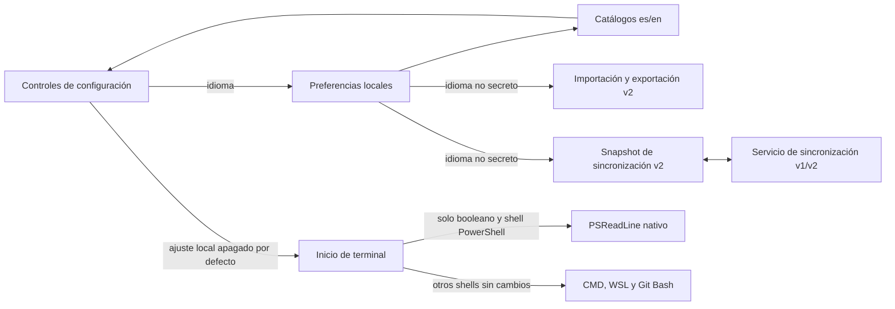

# Ajustes, idiomas y sugerencias locales de PowerShell

* **Autor:** Antonio Moles
* **Estado:** Aprobado para implementación; fase 1 con deuda de cobertura/validación visual, fase 2 pendiente de despliegue v2 y fase 3 implementada localmente
* **Fecha:** 2026-11-24

## El problema

La ventana de configuración de Laural presenta en una lista plana accesos a otros diálogos junto con preferencias del agente y controles de datos. Cuesta localizar una opción y no siempre queda claro si una fila abre otra pantalla o modifica un ajuste. La interfaz está en español, sin una preferencia para quienes necesitan usarla en inglés.

La terminal también carece de una sugerencia inline de comandos mientras se escribe. Añadir un predictor propio duplicaría capacidades del shell y podría exponer comandos del historial. En PowerShell se puede aprovechar la predicción local de PSReadLine con un ajuste opcional, sin cambiar la experiencia de otros shells.

## Visión general

La configuración organizará los controles existentes en cinco categorías: Personalización, IA, Agente y terminal, Datos y cuenta, y Aplicación. Los diálogos actuales de proveedores, cuenta/sincronización, importación/exportación y actualizaciones seguirán siendo responsables de sus funciones. Al cerrar un diálogo abierto desde Configuración, la app volverá a la categoría desde la que se abrió.

La interfaz añadirá español e inglés para todas las cadenas propias de Laural en estas superficies: navegación y categorías de ajustes; configuración de proveedores; agente y actividad; cuenta y sincronización; importación y exportación; actualizaciones; paneles de terminal y sus controles; chat, Markdown y bloques de comandos; paleta e historial de comandos; Git; ayuda; notificaciones; recetas de tareas; retención de copias; y nombres de temas. Se incluyen etiquetas visibles, controles, estados, validaciones, ayuda y nombres accesibles. El [plan de implementación](../plans/implementacion-ajustes-idiomas.md) vincula esas superficies a los archivos exactos y sus tareas. El selector solo se habilitará cuando todas las claves de estas superficies existan en ambos catálogos. Quedan fuera el texto de usuarios, las respuestas de proveedores/modelos, la entrada y salida del shell, las rutas, ramas Git, código y diff.

Los únicos mensajes libres de backend que pueden mostrarse sin traducción son el campo `message` de avisos públicos administrados y validados por `server/src/public-status.ts` (máximo 600 caracteres) y los mensajes de estado estáticos de Laural (`&'static str` en `src-tauri/src/account.rs`). El administrador redacta los avisos siempre en español y no incluye datos de usuario, secretos, rutas ni detalles de excepciones. La API devuelve códigos `error` estables, no texto libre: la interfaz los traduce mediante claves conocidas; las excepciones crudas y cualquier otro texto no se muestran. El contenido se representa como texto, sin interpretar HTML.

En el primer inicio se elegirá el idioma de Windows si está soportado; en otro caso, español. La preferencia se incluirá en importación/exportación y sincronización como dato no secreto. Si el campo falta o no es válido, se conserva el idioma local válido; si no existe, se detecta el idioma del sistema y se usa español como alternativa, sin descartar los demás ajustes.

Una opción local y apagada por defecto activará la sugerencia por historial de PSReadLine en las sesiones PowerShell de Laural. No se exportará ni sincronizará, no enviará comandos a servicios externos y no cambiará Tab, perfiles del usuario ni Registro. Otros shells mantendrán sus atajos nativos.

## Objetivos

- Agrupar los ajustes disponibles en cinco categorías navegables y accesibles, conservando un único control y propietario de persistencia por preferencia.
- Mantener el acceso a los diálogos existentes y ofrecer una ruta de regreso predecible a Configuración.
- Incorporar español e inglés completos para todas las cadenas del inventario de componentes del plan antes de habilitar el selector; conservar en español los avisos públicos validados y mensajes estáticos del backend, sin mostrar errores crudos.
- Usar una elección explícita de idioma de forma persistente; detectar el idioma de Windows solo al inicializar una instalación sin preferencia guardada.
- Transferir y sincronizar la preferencia de idioma como dato no secreto, manteniendo compatibilidad con configuraciones y clientes anteriores.
- Permitir, de forma optativa y local, las sugerencias nativas de historial de PSReadLine en PowerShell sin afectar otros shells ni ejecutar sugerencias automáticamente.
- Conservar el comportamiento actual de temas, apariencia, proveedores, cuenta, actualizaciones, permisos, copias e historial.

## Fuera de alcance

- Añadir idiomas aparte de español e inglés, traducción de texto de usuario, salida del shell o respuestas de proveedores.
- Reemplazar PSReadLine por un predictor propio, sugerencias generadas por IA, lectura propia del historial o cambios globales al shell, sus perfiles o el Registro.
- Sincronizar o exportar la preferencia de predicción de PowerShell.
- Rediseñar proveedores, autenticación, permisos del agente, almacén de credenciales, sincronización o actualizador.
- Convertir todos los diálogos existentes en una sola pantalla o añadir opciones sin una necesidad de usuario definida.

## Preguntas abiertas

No quedan decisiones de producto pendientes. Si PSReadLine está ausente o rechaza las opciones de predicción, la sesión PowerShell debe abrirse y aceptar comandos sin mostrar un error de configuración. La compatibilidad se comprobará en versiones presentes en los equipos de prueba.

## Recorridos principales

### Cambiar y transferir el idioma

- **Dado** que la persona usa Laural y tiene preferencias locales, y puede estar conectada o no a una cuenta.
- **Cuando** elige inglés en Personalización, reinicia la app y exporta la configuración para importarla en otro equipo.
- **Entonces** Laural muestra en inglés todas las cadenas del inventario de interfaz y guarda `language: "en"` en la exportación v2. Los avisos públicos validados y los mensajes estáticos del backend siguen apareciendo en español. Al importar un archivo v1 sin idioma, la app conserva un idioma local válido; si no existe, detecta el idioma del sistema y usa español como alternativa. Si sincroniza, el snapshot v2 conserva la elección sin incluir claves, permisos ni datos de terminal.

### Activar sugerencias locales de PowerShell

- **Dado** que la opción está desactivada por defecto y la persona abre una sesión PowerShell en Laural.
- **Cuando** activa la predicción local y abre una nueva sesión.
- **Entonces** PSReadLine muestra sugerencias de historial inline si está disponible; Tab conserva su autocompletado, Enter ejecuta el texto escrito y la sugerencia no se ejecuta sola. Otras shells y sesiones ya abiertas no cambian. La preferencia y el historial no se exportan ni sincronizan.

## Plan técnico (arquitectura)

### Organización de la configuración

`SettingsDialog` pasará a ser la entrada principal de configuración y su navegador de cinco categorías; no será el cascarón modal genérico de la aplicación. Mantendrá una categoría seleccionada y mostrará cinco entradas con estado seleccionado y foco visibles. En el ancho disponible de escritorio, las entradas irán en una columna lateral y el panel de contenido será desplazable. En ventanas estrechas, la navegación se convertirá en un selector accesible encima del panel. El diálogo tendrá un ancho mínimo de 900 CSS px, dentro de la ventana con ancho mínimo de 960 px que ya configura Tauri, y Personalización como destino inicial.

La capa de configuración no será propietaria de preferencias que hoy pertenecen a otros componentes o comandos. `App` seguirá siendo dueño del estado y renderizará Personalización sin añadir otra capa de apariencia. Se extraerá el comportamiento modal común actual a `ModalShell`, que conservará cierre, foco y semántica de diálogo. `SettingsDialog` usará ese cascarón para la navegación principal; Cuenta, Transferencia y Actualizaciones lo usarán directamente y mantendrán sus flujos independientes. Proveedores y controles del agente conservarán sus operaciones actuales. Se extraerá solo `AgentSettings` para aislar y probar los controles sensibles de permisos, mientras `App` mantiene la persistencia. Si un diálogo se abre desde Configuración, al cerrarlo se vuelve a la categoría que lo abrió.

### Idioma y catálogos

La interfaz utilizará catálogos TypeScript separados para español e inglés y una función pequeña de traducción con claves tipadas e interpolación de variables. No se añadirá una biblioteca hasta que la interfaz requiera pluralización o formato que los catálogos no cubran con claridad. La cobertura se verificará comparando las claves de ambos catálogos; no se habilitará inglés si falta alguna clave de los componentes y textos definidos en el inventario del plan de implementación. Si una clave falta durante desarrollo, se mostrará la clave o el texto español de forma visible en vez de ocultar el defecto.

Al iniciar una instalación sin idioma guardado, Laural leerá `navigator.language`, usará inglés para variantes `en`, español para variantes `es`, y español como alternativa para cualquier otro idioma. La selección queda persistida en `localStorage`; una elección manual no vuelve a cambiar por la detección del sistema. Al aplicar una importación o snapshot remoto con un idioma válido, se actualiza esa preferencia. Si el campo falta o no se reconoce, se conserva el idioma local válido; si no existe, se usa la detección inicial y después español. Así el formato antiguo no restablece preferencias no relacionadas.

Las cadenas propias de menús, diálogos, estados, ayuda, terminal y accesibilidad enumeradas en el plan utilizarán las mismas claves. El cliente mostrará mensajes de backend solo desde los campos aprobados y validados descritos arriba; los códigos de error se mapearán a textos de interfaz. Cuando no exista un mensaje aprobado, presentará un aviso genérico localizado. El texto escrito por el usuario, rutas, salida del shell y respuestas del proveedor conservarán su idioma original.

### Persistencia y compatibilidad

La preferencia de idioma será local y no secreta. Se añadirá a los formatos versionados de transferencia y snapshot, no a la política del agente ni al almacén de credenciales. La predicción de PowerShell seguirá siendo una opción local de `localStorage` y se excluirá de ambos formatos y del snapshot de nube.

El archivo de transferencia y el snapshot de sincronización tendrán una versión nueva con el campo `language`. La aplicación nueva continuará leyendo transferencias y snapshots v1: como no incluyen idioma, conservará el idioma local válido o inicializará la preferencia con el idioma del sistema y español como alternativa. Los campos restantes se procesarán según el contrato existente. Se conservarán lectores estrictos y validación de valores; no se aceptará un idioma desconocido ni se aplicará parcialmente un archivo inválido.

El servicio de sincronización aceptará v1 y v2 durante la transición. Un cliente antiguo que encuentre un snapshot v2 debe fallar de forma segura, no cargar su snapshot v1 sobre la revisión nueva y mostrar que hace falta actualizar Laural. Si el servicio aún no admite v2, el cliente mantiene la configuración local y marca la sincronización como pendiente o no disponible; nunca elimina ni sustituye el snapshot remoto en silencio. La actualización del servicio y de los esquemas compartidos debe preceder a publicar el cliente que escribe v2.

### Predicción local de PowerShell

El ajuste se guardará localmente y se pasará como booleano al crear una terminal. La rama PowerShell del `shell_command` existente, invocada por `create_terminal`, comprobará que `Set-PSReadLineOption` expone `PredictionSource` y `PredictionViewStyle` antes de solicitar `History` e `InlineView`; no se añadirá un módulo de inicio paralelo. La configuración se intentará con errores terminantes dentro de un bloque silencioso; si el cmdlet, los parámetros o los valores no son compatibles, se omitirá la predicción y la sesión continuará con su prompt, sin mostrar el error. El comando no contendrá texto de usuario ni valores de shell construidos desde la preferencia. Con la opción desactivada o en CMD, WSL y Git Bash, el comando de inicio actual no cambiará.

La preferencia afectará únicamente a sesiones PowerShell nuevas: cambiarla no inyectará comandos en una línea que ya esté escribiendo el usuario ni cambiará una sesión activa. El ajuste permanecerá desactivado por defecto. La descripción de la opción explicará que el historial puede contener comandos sensibles, que las sugerencias aparecen localmente y que no se envían a la IA, red o telemetría. No se capturará el texto sugerido desde el terminal.

### Fases de publicación independientes

- **Navegación:** reorganiza los ajustes y sus entradas sin exigir que el soporte de idioma o las sugerencias de PowerShell estén terminados.
- **Idioma y v2:** incorpora catálogos completos. Actualizar el servicio antes de publicar snapshots v2; la transferencia local nueva lee v1 y emite v2.
- **Predicción PowerShell:** incorporar por separado en el comando de inicio PowerShell existente. No modifica otras shells ni terminales ya abiertas.

### Flujo de datos

La separación mantiene el idioma como preferencia portable y limita la predicción al inicio local de PowerShell. Ningún flujo de configuración nuevo transportará claves API, historial de terminal, contenido del proyecto, permisos del agente o el valor de predicción.

## Alternativas consideradas

### Un único formulario largo para todos los ajustes

- **Ventajas:** no requiere navegación entre categorías y permite ver todos los controles de una vez.
- **Desventajas:** la lista actual ya mezcla acciones que abren otros diálogos con preferencias directas; al crecer, aumenta el desplazamiento y cuesta localizar una opción.
- **Decisión:** descartada en el brief aprobado. Se conservarán cinco categorías con destinos de diálogo claros y sin duplicar formularios.

### Unificar proveedores, cuenta, transferencia y actualizaciones en el nuevo diálogo

- **Ventajas:** todas las opciones quedarían bajo una sola ventana y no habría transiciones a otros diálogos.
- **Desventajas:** duplicaría o movería lógica de formularios que ya pertenece a componentes y flujos específicos, ampliando el riesgo de regresiones en credenciales, sincronización y actualizaciones.
- **Decisión:** aplazada. La ventana de ajustes será el punto de entrada y los diálogos existentes conservarán su responsabilidad, con retorno a la categoría de origen.

### Implementar un predictor de comandos dentro de Laural

- **Ventajas:** comportamiento potencialmente uniforme entre shells y control completo de la apariencia de la sugerencia.
- **Desventajas:** requiere leer historial, gestionar entrada y teclas en una terminal interactiva, y mantener diferencias entre PowerShell, CMD, WSL y Git Bash. También aumenta el riesgo de capturar o exponer comandos sensibles.
- **Decisión:** descartada en el brief aprobado. En PowerShell se reutilizará la predicción local de PSReadLine; los demás shells mantendrán sus atajos nativos.

### Cambiar Tab para aceptar una sugerencia

- **Ventajas:** aceptación rápida con una tecla conocida.
- **Desventajas:** Tab ya pertenece al autocompletado nativo del shell. Interceptarlo competiría con la selección de rutas, comandos y parámetros.
- **Decisión:** descartada en el brief aprobado. La sugerencia se acepta con el mecanismo nativo de PowerShell; Tab continúa completando.

### Activar la predicción mediante el perfil global o el Registro

- **Ventajas:** la configuración podría afectar también a PowerShell abierto fuera de Laural.
- **Desventajas:** cambia el entorno del usuario fuera de la aplicación, puede sobrescribir preferencias propias y requiere restaurar estado global.
- **Decisión:** descartada en el brief aprobado. La opción se aplica solo al iniciar una sesión nueva desde Laural y estará apagada por defecto.

### Añadir una biblioteca de internacionalización desde el primer día

- **Ventajas:** ofrece convenciones y funciones listas para traducción, pluralización y formatos regionales.
- **Desventajas:** añade dependencia y conceptos de mantenimiento antes de que la aplicación necesite esas funciones; para dos idiomas y textos de interfaz, catálogos tipados cubren el alcance inicial.
- **Decisión:** usar catálogos sencillos con comprobación de claves completas. Reconsiderar una biblioteca si se incorporan necesidades reales de pluralización o formato local.

### Detectar el idioma del sistema en cada inicio

- **Ventajas:** Laural seguiría automáticamente los cambios del idioma de Windows.
- **Desventajas:** podría reemplazar una elección manual que la persona espera conservar.
- **Decisión:** la detección se utiliza una sola vez, al inicializar una instalación sin idioma guardado. Después prevalece la selección explícita.

### Mantener los formatos de transferencia y sincronización en v1

- **Ventajas:** evita introducir un número de versión adicional y parece reducir el trabajo de migración.
- **Desventajas:** los lectores actuales rechazan campos desconocidos, los esquemas v1 declaran una lista cerrada y las versiones antiguas no pueden preservar el idioma al volver a escribir snapshots. Mantener el número v1 ocultaría un cambio real del contrato.
- **Decisión:** usar v2 para los formatos que incorporen el idioma y conservar lectura v1 en el cliente nuevo. El servicio aceptará ambas versiones durante la transición; los clientes antiguos que no entiendan v2 no podrán sobrescribirlo.

### Traducir los mensajes libres del backend

- **Ventajas:** conserva el detalle en el idioma en que el servicio lo genera y no requiere convertir cada respuesta libre en una clave de catálogo.
- **Desventajas:** una interfaz en inglés puede incluir una explicación en español; un backend que expusiera excepciones internas filtraría detalles sensibles.
- **Decisión del autor (2026-11-24):** los avisos públicos validados y mensajes estáticos del backend se muestran siempre en español; la interfaz oculta excepciones crudas y localiza los códigos de error.

## Requisitos no funcionales

### Seguridad y privacidad

- No transportar claves API, credenciales de cuenta, factores MFA/passkeys, historial/comandos, salida de terminal, rutas de proyecto ni reglas de ejecución en el snapshot de idioma.
- Mantener la predicción desactivada por defecto; activarla solo en sesiones PowerShell nuevas y locales. No editar perfiles o Registro, enviar texto al modelo, capturar la predicción ni añadir telemetría.
- Mostrar solo mensajes libres del backend que sean seguros para usuarios, siempre en español. No mostrar excepciones internas crudas; si no hay mensaje seguro, presentar un aviso de interfaz localizado.
- Validar estrictamente el idioma en transferencia y sincronización. Un cliente o servicio que no acepte v2 no debe reemplazar el snapshot actual ni descartar preferencias locales.

### Compatibilidad y despliegue

- Conservar lectura de formato v1 y emitir v2 al escribir idioma. Desplegar primero el servicio que admite snapshots v1/v2 y después publicar el cliente v2.
- Si la nube responde con una versión desconocida, dejar los datos locales intactos, detener la escritura y mostrar que se requiere actualizar Laural. No tratar un error de decodificación como una cuenta vacía.
- La aplicación seguirá disponible sin cuenta, sin conexión y sin PSReadLine compatible.

### Accesibilidad y rendimiento

- Toda categoría será accesible por teclado, con foco y selección visibles, nombres accesibles traducidos y contenido desplazable. El diálogo tendrá un ancho mínimo de 900 CSS px; la ventana de escritorio ya establece 960 px como ancho mínimo. En el espacio reducido disponible, se usará el selector compacto descrito en arquitectura.
- Los catálogos se cargarán localmente y no añadirán llamadas de red. No introducir dependencias de internacionalización para el alcance de dos idiomas y cadenas sin requisitos avanzados de pluralización.
- Probar textos largos en ambos idiomas, contraste del modo y los temas, y comportamiento con tecnologías de asistencia.

### Criterio de pruebas

Aplicar ADR-0052 y la política 100/80/0 por archivo: 100 % de líneas y ramas para flujos críticos de credenciales, transferencia, sync, permisos y ejecución de terminal; al menos 80 % de líneas para navegación y presentación con lógica; 0 % de tests propios y exclusión del denominador para catálogos declarativos, tipos, esquemas y fixtures. La igualdad de claves de los catálogos se comprobará en el build como validación de contrato, no como cobertura de los archivos declarativos. Informar resultados por categoría y no afirmar cumplimiento global si faltan gates.

## Recursos relacionados

- [ADR-0010: paletas y apariencia](../adr/0010-theme-and-appearance-preferences.md)
- [ADR-0013: configuración local](../adr/0013-configuracion-local.md)
- [ADR-0020: perfiles, portabilidad y sincronización](../adr/0020-perfiles-y-sincronizacion-opcional.md)
- [ADR-0052: cobertura 100/80/0](../adr/0052-politica-cobertura-100-80-0.md)
- [Política de cobertura](../development/coverage-policy.md)
- [Privacidad y seguridad](../security/privacy.md)
- [Guía de configuración actual](../configuracion.md)
- [Predicciones de PSReadLine](https://learn.microsoft.com/en-us/powershell/scripting/learn/shell/using-predictors?view=powershell-7.2)

## Implementation Plan

1. La navegación y reorganización de categorías se puede publicar de forma independiente.
2. La traducción español/inglés y el campo de idioma se entregan juntos. El servicio acepta v1/v2 antes de publicar el cliente v2.
3. La predicción de PSReadLine se implementa y publica como fase separada, integrada en la rama PowerShell del shell actual.

El inventario de archivos, tareas, pruebas clasificadas y criterios de cierre está en el [plan de implementación](../plans/implementacion-ajustes-idiomas.md).
