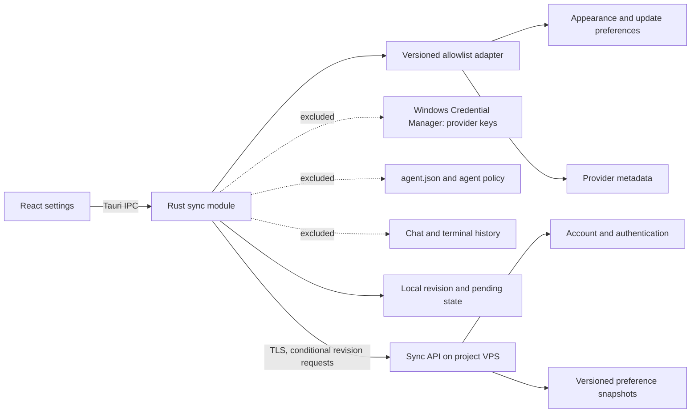

# Optional Preference Sync and Profile Portability

* **Author:** Antonio Moles
* **Status:** Approved; implementation pending
* **Date:** 2026-11-21

--------------------------------------------------------------------------------

## Overview

Laural will remain usable without an account and keep manual export/import available for device transfers. Users who opt into an account can synchronize a deliberately limited set of preferences and provider-profile metadata through the TypeScript/Fastify service hosted on the project owner's VPS at `https://sync.laurafernandezenfermeria.com`, backed by PostgreSQL. Saved local changes synchronize automatically, the client checks for remote changes every three hours while Laural is open, and Settings offers a **Sync now** action. API keys and other authentication secrets are never included in cloud sync.

--------------------------------------------------------------------------------

## The Problem

Laural's preferences are stored across multiple local stores, and users currently lack account-based synchronization between devices. Manual export/import supports user-controlled transfer, but it does not keep devices in sync after that transfer. A hosted sync option can reduce repeated setup while creating new risks around account recovery, service operation, privacy and accidental replacement of local or cloud preferences.

The feature must preserve local-only use and manual transfer as complete options. Cloud sync must be explicit, limited to an allowlist, and must not silently replace a newer snapshot. It must exclude API keys, credentials, chats, terminal data and project content. Since the first service is not end-to-end encrypted, its operator can read the allowed payload; this must be disclosed plainly.

--------------------------------------------------------------------------------

## Goals

* Keep Laural usable without an account or network connection, and retain manual export/import as an independent account-free transfer path.
* Let users opt into account sync for the approved preferences and provider-profile metadata only; never send API keys, passwords, OAuth tokens, passkeys or MFA secrets to the sync service.
* Host the initial TypeScript/Fastify and PostgreSQL sync service on the project owner's VPS at `https://sync.laurafernandezenfermeria.com`.
* Use Resend from the server backend for transactional account email; never expose its API key to the desktop client.
* Synchronize successfully saved local changes automatically, provide a user-triggered **Sync now** action, and check for remote changes every three hours while Laural is open.
* Ask before initial upload or whole-snapshot replacement, create a recoverable copy before replacement, and stop for user choice when both local and cloud revisions changed.
* Support email/password, Google, passkeys and MFA/TOTP in the first sync release. A six-digit email PIN is single-use, expires after five minutes, and is limited to email verification and recovery; it cannot sign in by itself or remove enrolled MFA.
* Route loss of all enrolled factors to a manual case review by the project administrator, who evaluates independent evidence and decides under a documented procedure. The email PIN alone never triggers factor removal.
* Keep custom provider endpoints excluded unless the user explicitly opts in for each provider profile.
* Provide a public, unauthenticated status page showing sync availability, active incidents, maintenance notices and progress updates without exposing user or infrastructure data.

--------------------------------------------------------------------------------

## Non-Goals

* Making account creation or the hosted service necessary for using Laural or transferring settings.
* Uploading API keys, passwords, OAuth tokens, passkeys, MFA secrets, chats, terminal history or commands, project files or paths, local activity, or agent execution rules.
* End-to-end encryption in the first hosted-sync release.
* Field-level merge or silent last-write-wins conflict resolution in the first version.
* General-purpose synchronization of arbitrary application data.
* Automatic removal of MFA or passkeys based only on mailbox access or possession of the email PIN.
* Publishing account data, logs, credentials, private incident evidence or detailed infrastructure diagnostics on the status page.

--------------------------------------------------------------------------------

## Backup and account-recovery policy

### No off-site copies

* **Accepted decision:** Laural will not send disaster-recovery backups outside the VPS. No off-site storage or external backup provider is part of this service.
* No disaster backup is currently configured. Whether to keep a local database copy on the same VPS is a separate choice and remains undecided; do not describe such a copy as disaster recovery.
* A total VPS loss, disk failure, or destructive compromise may permanently erase accounts and cloud preference snapshots. There is no recovery-point or recovery-time guarantee after total host loss. The service must disclose this before account sync is enabled.
* Laural remains local-first: sync is optional, local settings continue working, and users should retain their devices or use manual export/import when implemented. Cloud sync must not be presented as the only copy of a user's configuration.

### Lost-factor account recovery (recommended runbook)

* When a user enrolls MFA, generate single-use recovery codes, show them once, store only verifiers on the service, and require the user to confirm they saved them.
* The six-digit email PIN proves control of the mailbox only. It may open a support case but never grants a session or removes MFA by itself.
* The administrator reviews the case and requires the email PIN plus at least one pre-existing independent proof: a valid recovery code, another enrolled factor, a linked Google identity, or a still-authenticated trusted device. Record the evidence category and decision, not evidence contents, and notify the account's registered email address.
* If no independent proof remains, do not bypass MFA based on personal details, provider names, or configuration trivia. Explain that the account cannot be safely recovered and let the user create a new account. This avoids making the support process weaker than sign-in; OWASP notes that recovery is an alternate authentication path and that MFA bypass/reset can be exploited.
* On approval, revoke every session, remove only the lost factors, require the user to set up a new factor at next sign-in, and retain a minimal decision audit. No public endpoint or public admin panel can perform this action.

The no-off-site-copy decision is accepted. The recovery-code feature, administrator procedure and disclosures still need implementation and verification before public account sync. The runbook recommendation follows [OWASP MFA guidance](https://cheatsheetseries.owasp.org/cheatsheets/Multifactor_Authentication_Cheat_Sheet.html), which recommends single-use recovery codes and warns that MFA reset paths can be exploited.

--------------------------------------------------------------------------------

## Critical User Journeys

### Transfer configuration without an account

* **Given**: The user has a local Laural profile and no sync account.
* **When**: They export configuration, optionally include API keys, set a password when keys are included, and import the file on another device.
* **Then**: The app previews the file, validates it before changing local state, writes imported keys directly to Windows Credential Manager, and leaves the user able to continue without signing in.

### Enable sync on a second device

* **Given**: The user has an account and a local profile; the cloud may be empty or contain a different snapshot.
* **When**: They sign in and enable sync.
* **Then**: An empty cloud requires confirmation before first upload. If both sides differ, the app asks which complete snapshot to keep without a field diff and backs up the side to be replaced.

### Work offline and resolve a concurrent edit

* **Given**: Sync is enabled and a device loses network access or another device changes the cloud snapshot.
* **When**: The user saves settings offline, reconnects, or presses **Sync now**.
* **Then**: Local settings remain saved and pending is visible. A stale cloud revision stops automatic writes and prompts for a whole-snapshot choice; no last-write-wins overwrite occurs.

### Recover an account after losing all factors

* **Given**: The user cannot use any enrolled passkey, TOTP factor or recovery code but can request email recovery.
* **When**: They verify mailbox access with the single-use five-minute PIN and submit a case for administrator review.
* **Then**: The PIN alone changes no factors. The administrator evaluates independent evidence and approves or rejects the case. Approval revokes sessions and factors, records a minimal audit event, and notifies the user.

--------------------------------------------------------------------------------

## Technical Plan (Architecture)

### Existing application boundaries

Laural is a Tauri 2 desktop application with a React/TypeScript interface and Rust commands registered through Tauri IPC. The current data is split across stores:

* `localStorage` contains appearance and update preferences as well as chat history. Only explicitly selected preference keys may enter a sync snapshot; chat history is excluded.
* `providers.json` contains provider profile metadata. It is the source for the allowlisted provider fields, but must be read through a typed adapter rather than uploaded as a whole file.
* Windows Credential Manager contains provider API keys. Sync code must have no read path to provider credentials.
* `agent.json` contains agent execution policy. It is excluded from this sync scope.

### Desktop components

Add a Rust sync module behind a small set of Tauri commands. It will own snapshot creation and validation, revision state, persistence of pending work, network requests, and safe application of a chosen remote snapshot. A versioned, closed snapshot type will map only approved appearance/update fields and approved provider-profile metadata. Custom endpoint values enter this type only for profiles whose owners explicitly opted in. Unknown required schema versions, malformed responses, partial responses, and invalid fields fail closed and leave local configuration unchanged.

The React settings interface will start or stop sync, show the last successful check and pending/error/conflict state, offer **Sync now**, request the first-upload choice, and present the whole-snapshot conflict choice. It will not receive provider keys or account tokens through UI state. Sync credentials (including refresh credentials, if the selected auth protocol uses them) belong in Windows Credential Manager; the local JSON state may hold only non-secret fields such as the last acknowledged revision, schema version, and a bounded pending-change marker.

Before replacing settings, the desktop layer will create recoverable local copies of every affected non-secret store. It will not put Credential Manager entries into those copies. Local settings are saved before network work; a network failure leaves local use available and retains a bounded, durable pending state. A replacement is applied only after the backup succeeds and the user chooses which whole snapshot to keep.

### Sync service components

The service hosted on the owner's VPS will be a TypeScript/Fastify application backed by PostgreSQL and published at `https://sync.laurafernandezenfermeria.com`. It will expose separate account/authentication and preference-snapshot responsibilities. It will authenticate the user, authorize every snapshot read/write against the authenticated account, validate the versioned allowlist, enforce payload and request limits, and use conditional revision updates. A retry of a request must be safe, and a stale revision must not replace newer cloud data. The service stores no provider API keys and provides no sync endpoint for chats, terminal data, project content, or agent rules.

The service will use TLS in transit and server-side encryption for stored data and backups. It will not claim end-to-end encryption: the VPS operator can read the permitted snapshot. Operational records use an allowlist of event type, result, duration, client/schema version and opaque operation ID; they exclude payloads, diffs, email addresses, endpoint URLs, IP addresses, tokens and raw exception details. Manual administrator recovery of lost factors is a separately authorized, audited account action; it must not be triggered by the six-digit email PIN alone.

The deployment uses a service container, PostgreSQL, and a reverse proxy with TLS on the dedicated sync subdomain. Transactional account messages are delivered through Resend. Its sending API key, Google OAuth secrets, encryption keys and database passwords are supplied by the VPS environment and are never stored in the repository. Resend must receive a verified sending domain and a restricted sending key before production; the exact sender address remains to be selected. The design does not add a public administrator dashboard.

### Public service status

Anyone can open `https://sync.laurafernandezenfermeria.com/status` without an account. The page shows a small set of component states (service/API, synchronization and email delivery), the overall state (operational, degraded, outage or maintenance), the last check time, active incidents, scheduled maintenance and timestamped public updates. Incident progress uses plain states such as investigating, identified, monitoring and resolved, with short public descriptions of the current action. A public status response contains no account identifiers, request logs, IP addresses, internal hostnames, secrets or raw error messages. If a check cannot be completed, the page says status could not be verified and shows the time of the last successful check rather than claiming the service is operational.

Health checks report only whether the service and its required dependencies respond; they do not expose diagnostic details. The administrator publishes and updates incident notices through an operator-only command over VPS SSH. The command accepts bounded public text, requires a status and incident category, timestamps each update and writes a small public status document atomically. The author chose to serve the static page through the reverse proxy on the sync VPS, independently of the API process; it can therefore remain available during an application or database outage. If the entire VPS or its network is unavailable, the status page will also be unavailable.

### Sync behavior and data flow

1. When a user enables sync, the app authenticates and reads local snapshot metadata and the cloud snapshot state.
2. If cloud state is absent, the app asks before uploading the local snapshot. If both snapshots exist and differ, it asks which complete snapshot to keep, identifies the side to be replaced, and confirms that a recoverable copy will be made. It does not show a field-level diff or merge.
3. A successful local preference save updates the local store first. The sync module coalesces rapid changes and attempts a conditional upload. A failed upload remains visibly pending.
4. While the app is open and sync is enabled, it checks for remote revision changes every three hours. A local save can trigger an earlier upload; **Sync now** triggers an immediate check and sync attempt. Closed apps do not run a background task. On next launch the app resumes pending work and checks the current revision.
5. If local pending changes and the remote revision both advanced from the last acknowledged revision, the app stops automatic writes and asks which whole snapshot to keep. It backs up the side to be replaced before applying the choice.
6. When the service is unavailable, the app preserves local settings and pending state. It never treats a timeout, malformed response, corrupt snapshot, or unsupported future schema as an empty cloud account.

### Authentication and account recovery boundaries

The native desktop app must not embed a shared OAuth client secret or collect account passwords in the WebView. **Sign in** opens the external browser to a first-party auth page served from the sync origin. That page supports registration, email/password, Google, passkeys and TOTP; Google uses Authorization Code with PKCE. Successful authentication returns a one-use authorization code to a random-port loopback listener bound to `127.0.0.1`; Rust exchanges it and stores the refresh credential in Windows Credential Manager. Passkey challenges and credential verification use WebAuthn with `sync.laurafernandezenfermeria.com` as the relying-party origin and ID. Password hashes, TOTP seeds, recovery codes and session tokens are authentication data, not preference snapshot fields.

Email PINs are six digits, single-use, expire after five minutes, are rate-limited and stored only as keyed verifiers. They verify an address or support recovery; they do not provide passwordless login and cannot remove an enrolled factor. If every enrolled factor is lost, the user contacts the project administrator, who evaluates independent evidence and applies documented judgment. An operator-only command on the VPS records approval or rejection; approval removes the enrolled factors, revokes all sessions and sends a notice. Evidence itself is not copied into application logs.

### Architectural constraints

* Preserve the existing Tauri IPC boundary; do not give the WebView direct access to auth tokens or arbitrary filesystem stores.
* Use a typed allowlist and explicit adapters; never serialize the full application configuration, Credential Manager, or agent policy.
* Keep settings available offline and save locally before cloud operations.
* Use conditional revisions, idempotent requests, bounded retries and visible sync state; no silent last-write-wins.
* Keep local and cloud recovery copies without automatic expiry, while exposing user-controlled deletion and honoring account deletion for all cloud copies.
* Do not log secrets, snapshot contents, field diffs, endpoint URLs or personal account identifiers.

--------------------------------------------------------------------------------

## Alternatives Considered

### Local-only configuration

* **Pros**: Keeps preferences on the device, avoids account and hosting costs, and remains available offline.
* **Cons**: Does not keep multiple devices updated after a one-time transfer.
* **Reason for rejection**: Rejected by author as the only mode because recurring multi-device synchronization is a stated goal. It remains the default account-free mode and must continue to work if the sync service is unavailable.

### Manual export/import without an account

* **Pros**: Supports device transfer without an account or Laural service and keeps the user in control of when to transfer.
* **Cons**: Requires a new manual operation for each transfer and does not reconcile ongoing changes between devices.
* **Reason for rejection**: Rejected by author as the sole transfer mechanism because it does not provide recurring synchronization. It remains a complete, independent option for users who do not want an account.

### User-managed cloud drive or file synchronization

* **Pros**: Avoids operating Laural identity and sync infrastructure.
* **Cons**: Leaves file conflicts, device access, deletion, and data protection to the user and storage provider; it cannot enforce Laural's revision or account-isolation rules.
* **Reason for rejection**: Rejected by author for the initial hosted-sync feature because it does not provide a controlled synchronization contract. It could be revisited if users request a documented self-managed file format.

### First-party service with server-readable preference snapshots

* **Pros**: Supports account access across devices, account recovery, and conditional revisions under one service contract.
* **Cons**: Requires ongoing VPS operation, email delivery, abuse handling, backups, privacy controls, and incident response. The service operator can read the allowed preference payload because the first release is not end-to-end encrypted.
* **Reason for selection**: Selected by author for the official service hosted on the project VPS, with sync remaining optional and the server-readable data boundary disclosed.

### End-to-end encrypted synchronization

* **Pros**: Prevents the service operator from reading preference snapshots.
* **Cons**: Requires client-side key creation, device enrollment, key recovery, and account-recovery rules that cannot silently bypass encryption. These become difficult when users lose all devices or factors.
* **Reason for rejection**: Deferred by author for the first release because key recovery and device enrollment add unresolved complexity. Revisit if confidentiality from the service operator becomes a requirement; do not imply E2EE in the initial service.

### Field-level diff and merge for conflicts

* **Pros**: Can preserve independent changes made on multiple devices.
* **Cons**: Adds merge rules for provider IDs, endpoint consent, schema migrations, and partially overlapping changes. A detailed diff also exposes configuration details in a conflict dialog.
* **Reason for rejection**: Rejected by author for the first version in favor of choosing one complete snapshot without a field-level diff. The accidental-loss risk is handled with a generic replacement warning and recoverable copies before replacement.

### Add sign-in methods in phases

* **Pros**: Reduces the first backend release scope and allows each authentication method to ship separately.
* **Cons**: Delays the requested methods and requires support for a period with an incomplete sign-in and recovery model.
* **Reason for rejection**: Rejected by author; email/password, Google, passkeys, and MFA/TOTP are required in the first sync release.

### Windows background task for closed-app checks

* **Pros**: Could check or upload pending changes while Laural is closed.
* **Cons**: Adds an installed background component, lifecycle and update/uninstall behavior, additional credential access, and more operational edge cases. It also runs contrary to the user's choice to check every three hours while Laural is open.
* **Reason for rejection**: Rejected by author for the initial design; checks run only while Laural is open. The app catches up on launch.

--------------------------------------------------------------------------------

## Non-Functional Requirements

* **Security and privacy**: Use TLS, account-scoped authorization, typed allowlists, strict input and size validation, revocable sessions, safe credential storage and payload-free logs. The service operator can read allowed sync data; the UI and privacy documentation must state this because the first release is not end-to-end encrypted.
* **Reliability**: Local changes succeed independently of network access. Sync uses conditional revisions, idempotent writes, durable bounded pending state, recoverable backups before replacement, and visible failure/conflict states.
* **Performance**: A serialized preference snapshot cannot exceed 256 KiB. Network work runs outside the UI thread; repeated local saves are coalesced.
* **Data lifecycle**: User-visible recovery copies do not expire automatically and can be deleted by the user. Account deletion removes the live account and user-visible cloud copies. No disaster-recovery backup leaves the VPS; total host loss may make cloud data unrecoverable. Any future same-host copy needs a separate retention/deletion rule and must not be called off-site recovery.
* **Status availability**: The unauthenticated page is served from the sync VPS outside the API process. It can report API/database failures while the VPS and reverse proxy remain online, but cannot report a total VPS or network outage from that same host.

--------------------------------------------------------------------------------

### Additional Resources

* [Concepts brief](../plans/concepts_brief.md) — approved problem scope and author decisions.
* [Implementation specification](../plans/sincronizacion-preferencias.md) — approved scope, stages and acceptance criteria.
* [ADR-0005](../adr/0005-windows-credential-storage.md) — provider credential storage boundary.
* [ADR-0009](../adr/0009-local-json-profile-storage.md) — local provider profile storage.
* [ADR-0015](../adr/0015-csp-y-minimo-de-permisos.md) — Tauri WebView policy and capability boundary.
* [ADR-0020](../adr/0020-perfiles-y-sincronizacion-opcional.md) — accepted product decision for portability and optional sync.
* [ADR-0022](../adr/0022-cifrado-de-exportaciones-y-claves-locales.md) — encrypted configuration export decisions.
* [Privacy policy](../security/privacy.md) and [threat model](../security/threat-model.md) — current privacy and threat boundaries.

--------------------------------------------------------------------------------

## Detailed Implementation Plan

Implement the work in order. Keep local-only use working at each stage. Update the roadmap, backlog, changelog, security documentation and relevant use cases in the same change as each user-visible capability.

### Implementation sequence

1. **Snapshot contract and local adapter.** Add the version-1 schema and typed desktop model. Capture only theme, appearance, update preference, active profile, and provider metadata. Store endpoint consent per provider and default it to false. Keep chat, terminal, agent rules, project context, credentials and local paths out of the snapshot. Migrate older provider profiles without changing profile IDs or endpoint values.
2. **Account-free transfer.** Build encrypted export/import and preview before cloud sync. Exclude keys by default; require a password if the user opts into keys. Use bounded Argon2id parameters and authenticated encryption from maintained libraries. Decrypt only in memory and write imported keys directly to Windows Credential Manager. Reject invalid files before changing local settings; back up and roll back replacement/import failures.
3. **Service and identity.** Create the Fastify/PostgreSQL service, schema migration, account routes and all four requested authentication methods. Use generic auth errors, rate limits, revocable sessions, verified email, WebAuthn ceremonies on the official sync origin, TOTP, one-use recovery codes, and six-digit email PINs with a five-minute expiry. Create an admin-only VPS operation for manual recovery; do not expose factor removal through a public API.
4. **Cloud sync.** Add conditional revision reads/writes and idempotency keys. First upload, replacement, and conflict resolution require a user choice and a recoverable copy. Save locally first, keep pending changes durable and visible when offline, and never overwrite a revision that changed elsewhere. Sync on a successful local settings save, on **Sync now**, every three hours while the app is open, and after app resume/startup if the last check is due.
5. **Release and operations.** Deploy at `https://sync.laurafernandezenfermeria.com` behind TLS. Add database backup/restore, account deletion, delivery and recovery runbooks, sanitized operational logs, dependency scanning and coverage gates before opening registration.
6. **Public status.** Serve a no-login status page at `/status`, show limited health results and publish maintenance/incident updates through an authenticated VPS operator action. Ensure the static page is independent of the API process.

The service API contract is documented in `server/openapi.yaml`: `POST /v1/auth/native/start` creates a short-lived browser flow with PKCE and state; browser routes handle registration, login, Google, passkey, TOTP, email verification and recovery; successful browser authentication redirects to the one-use loopback callback held by Laural; `POST /v1/auth/native/exchange` exchanges its one-use code. `GET /v1/preferences/current` returns the snapshot and revision; `PUT /v1/preferences/current` requires `If-Match` and an idempotency key. Session listing/revocation and account deletion are authenticated endpoints. The API rejects credential or out-of-scope fields even if a client submits them.

The unauthenticated status API exposes only aggregate readiness and the current public incident document. The reverse proxy serves the static status page and announcement document directly; admin updates are published through the operator command, not an unauthenticated write endpoint.

### Target files to create or modify

Unless noted otherwise, paths in this table are relative to the repository root.

| File | Change and reason |
| --- | --- |
| `shared/preference-snapshot-v1.schema.json` (create) | Canonical closed schema for API payloads and fixtures; prevents broad configuration serialization. Maximum snapshot size: 256 KiB. |
| `shared/fixtures/preference-snapshot-v1.json` (create) | Valid non-secret fixture shared by Rust, TypeScript and server contract tests. |
| `src/sync/contracts.ts` (create) | Frontend types for sync status and the versioned preference snapshot. Contains no secret fields. |
| `src/App.tsx` (modify) | Notify Rust after successful theme, appearance and update-preference saves; do not connect chat or terminal history writes to sync. |
| `src/components/UpdateManager.tsx` (modify) | Notify the preference adapter after the update setting is saved so it follows the same local-first synchronization path. |
| `src/App.css` (modify) | Style sync state, conflict choice and secure transfer UI using existing theme tokens and accessibility states. |
| `src/components/SettingsDialog.tsx` (modify) | Host the account, sync status, endpoint-consent and transfer sections in existing Settings. |
| `src/components/SyncSettings.tsx` (create) | Login launch, sync enablement, first-upload choice, **Sync now**, status, conflict choice, device revocation, endpoint consent and account deletion UI. |
| `src/components/ConfigurationTransfer.tsx` (create) | Export/import choices, explicit key inclusion, password entry, preview, merge/replacement confirmation and safe error display. |
| `src-tauri/src/lib.rs` (modify) | Register bounded commands for preference snapshot, sync, external-browser authentication and configuration transfer. |
| `src-tauri/src/providers.rs` (modify) | Add provider kind and per-profile custom-endpoint consent with a false default; preserve existing IDs and destinations during migration. Expose only non-secret metadata to sync. |
| `src-tauri/src/preferences/mod.rs` (create) | Own preference snapshot, local sync state, transfer, crypto and sync-client submodules. |
| `src-tauri/src/preferences/snapshot.rs` (create) | Build and validate the allowlisted snapshot and reject unknown, malformed or oversized input. |
| `src-tauri/src/preferences/state.rs` (create) | Persist only non-secret schema/revision/check/pending metadata with atomic, bounded writes. |
| `src-tauri/src/preferences/auth.rs` (create) | Launch the fixed external authentication origin, create a random loopback listener/state/PKCE verifier, and exchange one-use auth codes. |
| `src-tauri/src/preferences/transfer.rs` (create) | Read/write the versioned export format; preview, validate, back up, merge/replace and roll back imports. |
| `src-tauri/src/preferences/crypto.rs` (create) | Versioned Argon2id key derivation and AES-256-GCM authenticated encryption envelope for key-bearing exports; never implement primitives locally. |
| `src-tauri/src/preferences/sync.rs` (create) | HTTP client, conditional revisions, retry/coalescing, three-hour open-app check, resume check, conflict stop and pending state. |
| `src-tauri/Cargo.toml` and `src-tauri/Cargo.lock` (modify) | Add maintained authenticated-encryption and external-browser dependencies; pin the resolved dependency graph. |
| `src-tauri/capabilities/default.json` (modify) | Grant only the specific opener permission needed to launch the fixed official authentication origin. |
| `package.json` and `package-lock.json` (modify) | Add the opener plugin client and scripts for service build/test/coverage. |
| `server/package.json`, `server/package-lock.json`, `server/tsconfig.json` (create) | Define the TypeScript/Fastify service and pinned production/test dependencies. |
| `server/.env.example` (create) | Document required non-secret variable names and the official origin; use empty placeholders, never real credentials. |
| `server/src/app.ts` (create) | Build an injectable Fastify app for tests without starting listeners or background work. |
| `server/src/main.ts` (create) | Start the service, validate configuration and shut down database/network resources safely. |
| `server/src/config.ts` and `server/src/database.ts` (create) | Validate environment variables and manage PostgreSQL connections with parameterized SQL. |
| `server/src/plugins/security.ts`, `server/src/plugins/authenticate.ts` (create) | Set security headers, strict origin handling, request limits/rate limits and account-scoped session authentication. |
| `server/src/routes/auth.ts`, `server/src/routes/preferences.ts`, `server/src/routes/account.ts`, `server/src/routes/recovery.ts` (create) | Expose validated, rate-limited account, sync, deletion and recovery-request routes. Every data query is scoped to the authenticated account. |
| `server/src/auth/password.ts`, `server/src/auth/google.ts`, `server/src/auth/passkeys.ts`, `server/src/auth/totp.ts`, `server/src/auth/email-pin.ts` (create) | Separate the four authentication methods and PIN verification while keeping secrets out of preference data. |
| `server/src/preferences.ts`, `server/src/recovery.ts`, `server/src/deletion.ts`, `server/src/email.ts` (create) | Implement snapshot revisions, manual case workflow, deletion propagation and transactional email templates/delivery. |
| `server/web/auth.html`, `server/web/auth.js`, `server/web/auth.css` (create) and `server/src/routes/web-auth.ts` (create) | Serve a same-origin browser-only sign-in/registration surface so WebAuthn uses the official HTTPS origin; keep credentials out of the Tauri WebView. |
| `server/web/status.html`, `server/web/status.js`, `server/web/status.css` (create) | Provide a Spanish, unauthenticated status page with service states, maintenance windows and incident updates; display stale/unknown status honestly. |
| `server/status/announcements.json` (runtime file, not committed) and `server/src/admin/update-status.ts` (create) | Persist bounded public notices on the VPS and let the administrator publish, update and resolve notices over SSH without relying on the API database. |
| `server/src/routes/status.ts` (create) | Expose read-only aggregate health checks with no personal or infrastructure details. |
| `server/openapi.yaml` (create) | Specify request/response schemas, auth steps, revision headers, error categories and size limits as the API contract. |
| `server/src/admin/review-recovery.ts` (create) | Operator-only command over VPS SSH to approve/reject a reviewed case, revoke factors/sessions, notify the user and append a minimal audit event. No public reset route or admin web panel. |
| `server/migrations/001-initial.sql` (create) | Create account, identity, passkey, TOTP, recovery-code, PIN, session/device, snapshot/recovery-copy, deletion and admin-audit tables with account-scoped keys and indexes. |
| `server/Dockerfile`, `server/compose.yaml`, `server/deploy/Caddyfile` (create) | Run the API and PostgreSQL locally and on the VPS; terminate TLS, route `/v1` to the API, and serve `/status` plus its public announcement document as static files outside the API process. Inject production secrets outside source control. |
| `tests/configuration-transfer.test.tsx`, `tests/sync-settings.test.tsx`, `tests/sync-preferences.test.ts` (create) | Cover transfer UX, password/key consent, sync state, automatic triggers, three-hour schedule and whole-snapshot conflicts. |
| `tests/app.test.tsx`, `tests/update-manager.test.tsx` (modify) | Prove local chat and terminal history never enter sync payloads and update preference saves trigger only the allowlisted path. |
| `tests/settings-dialog.test.tsx` (modify) | Verify the new settings sections are reachable and preserve the existing dialog behavior. |
| `src-tauri/tests/preferences_transfer.rs`, `src-tauri/tests/sync_contract.rs`, `src-tauri/tests/sync_client.rs` (create) | Test crypto tampering/limits, keyring failure and rollback, exact allowlist, endpoint opt-in, schema rejection, stale revisions, idempotency and offline restart. |
| `server/tests/auth.test.ts`, `server/tests/preferences.test.ts`, `server/tests/recovery.test.ts`, `server/tests/account-isolation.test.ts`, `server/tests/status.test.ts` (create) | Exercise every login/recovery flow, PIN expiry/reuse/rate limits, session revocation, account isolation, revision conflicts, deletion, status redaction and operator-only notice updates against disposable PostgreSQL or isolated status fixtures. |
| `.github/workflows/cobertura.yml` (modify) | Run frontend, Rust and server suites and publish separate coverage results; require at least 85% line and branch coverage for feature-critical business logic. |
| `docs/adr/0020-perfiles-y-sincronizacion-opcional.md`, `docs/adr/README.md` (modify) | Replace the proposal's conflicting diff/merge and scope text with approved behavior and register the new decision. |
| `docs/adr/0023-servicio-de-sincronizacion.md` (create) | Record Fastify/PostgreSQL, API origin, revision protocol, backup/deletion boundary and administrator recovery decisions. |
| `docs/plans/concepts_brief.md`, `docs/plans/sincronizacion-preferencias.md`, `docs/ROADMAP.md`, `docs/BACKLOG.md`, `docs/PRODUCT_BRIEF.md`, `docs/architecture/overview.md` (modify) | Keep feature scope, architecture, milestones and backlog aligned with delivery. |
| `docs/configuracion.md`, `docs/instalacion.md`, `docs/security/privacy.md`, `docs/security/threat-model.md`, `docs/security/README.md`, `SUPPORT.md` (modify) | Explain setup, account-free transfer, sync exclusions, service-readable data, recovery, deletion, public status limitations, threats and operator procedures. |
| `docs/security/account-recovery-runbook.md` (create) | Give the administrator the manual evidence-review, decision, notification, session-revocation and audit steps; mailbox PIN alone is insufficient. |
| `docs/use-cases/README.md`, `docs/requirements/README.md` (modify), `docs/use-cases/sincronizacion-preferencias.md` (create) | Document and index local transfer, first login, conflict, outage, factor loss, revocation and deletion journeys. |
| `README.md`, `docs/README.md`, `CHANGELOG.md` (modify) | Publish project setup, feature navigation, user-visible changes and release notes. |

### Security and correctness checks

* Use parameterized PostgreSQL queries, per-account authorization in the service layer, strict request schemas, HTTPS-only origin validation, no open redirects, random OAuth state, PKCE, one-use loopback authorization codes and short-lived WebAuthn challenges.
* Apply generic responses for registration, login, PIN requests and recovery requests. Rate-limit by account/action and network source, cap body size and active sessions, and avoid storing IP addresses in routine application logs.
* Store refresh credentials only in Windows Credential Manager. Hash passwords with Argon2id; store one-use codes as hashes; store PIN verifiers with a server-side keyed verifier; encrypt TOTP seeds at rest. Provider API keys remain in the existing Windows Credential Manager namespace and never enter server requests.
* Persist user-visible recovery snapshots until user deletion, with no automatic expiry. Account deletion removes the live account, its cloud snapshots, sessions and factors. Do not send disaster-recovery backups outside the VPS; disclose that total VPS loss can destroy cloud data.
* Require an admin recovery runbook before enabling recovery. The PIN only proves mailbox access; the administrator records a decision category, revokes all active sessions on approval, removes existing factors only after reviewing independent evidence, and sends a security notice. Evidence documents and PINs are not stored in application logs.
* Test that the WebView cannot make arbitrary network requests; all service traffic passes through the Rust client. Keep the opener restricted to the configured HTTPS sync origin and Google authorization URLs.

### Verification plan

* **Builds**: `npm run build`, `cargo check --manifest-path src-tauri/Cargo.toml`, and `npm --prefix server run build`.
* **Coverage**: `npm run test:coverage` and `npm --prefix server run test:coverage`; report frontend, Rust and server coverage separately and fail below 85% lines or branches in sync, transfer, authentication and recovery logic.
* **Integration/security**: verify shared schema fixtures in Rust and TypeScript; prove cross-account read/write rejection, no secret fields in sync, no key-bearing plaintext temporary files, failed imports leave configuration unchanged, email PIN cannot log in or remove factors, admin operation cannot be invoked over HTTP, and all administrative actions are audited.
* **Windows manual checks**: install, upgrade, PowerShell/CMD/WSL/Git Bash, local-only use, import/export with and without keys, all sign-in methods, passkey callback, offline pending recovery, conflict choice, endpoint consent, service outage, revocation and account deletion.
* **Operations**: verify the no-off-VPS-backup disclosure, check TLS certificate renewal, validate Resend delivery and PIN expiration, scan both lockfiles for vulnerabilities and secrets, and inspect logs for forbidden values before opening registration.

### Release blockers to resolve

* Document whether a same-VPS database copy will be configured and its retention/deletion behavior. It does not protect against total VPS loss; no off-site copy is allowed by the accepted decision.
* Approve the administrator recovery runbook's evidence checklist and notification timing before enabling requests.

--------------------------------------------------------------------------------

*Drafted with EGM*
